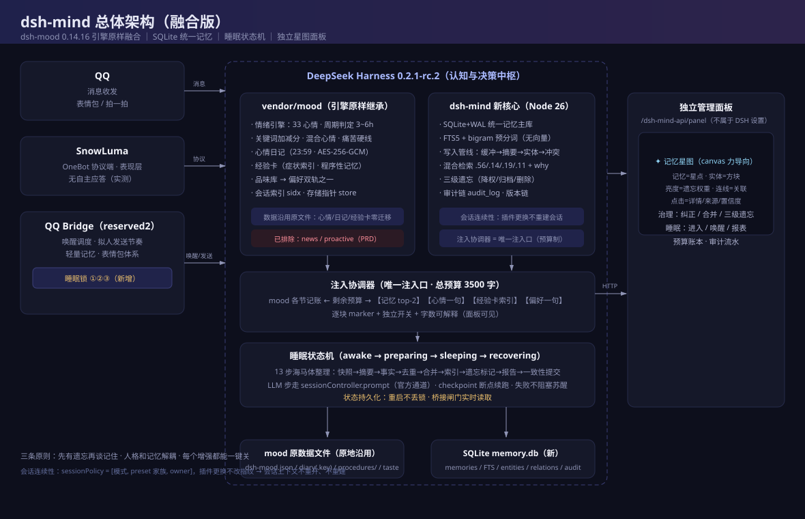

# Fathom · 深寻

[简体中文](README.md) | **English**

**Long-term memory, dynamic emotion and sleep for AI agents.**

SQLite memory store · FTS5 Chinese retrieval · prompt injection · four-state sleep machine · 3D memory galaxy panel



> `fathom` is a unit of water depth — and a verb meaning "to understand deeply". Memory retrieval is a dive: you go down and bring back the thing that had sunk.

**MIT licensed · zero runtime dependencies · no build step for the panel · all data in one local SQLite file**

- Repository: <https://github.com/ZeZhizhan/Fathom>
- Issues: <https://github.com/ZeZhizhan/Fathom/issues>

---

## What it is

A plugin for DeepSeek Harness (DSH). Once installed, the agent writes the parts of a conversation worth keeping into a local database, retrieves them when a related topic comes up, and injects them into the system prompt. It also maintains an emotional state and a daily rhythm — it gets tired, it sleeps, and it is groggy right after waking up. Everything is visible and editable in a 3D memory galaxy panel.

| Module | What it does |
|---|---|
| **Memory** | SQLite + FTS5 with Chinese bigram tokenization; survives sessions and context compaction |
| **Injection** | Each turn injects the most relevant memories within a token budget, full text included |
| **Sleep** | Four-state machine + fatigue value, recomputed from real elapsed time (no timers) |
| **Galaxy** | Semantic clusters + a bright core, Three.js particle shader with a hand-written bloom pass |
| **Mood** | 33 emotion dimensions (basic / compound / modern slang groups) |
| **Diary / Procedures / Taste** | Daily diary, procedural card library, the agent's own preference principles |
| **Memory governance** | Search, filter, sort, edit, down-weight, hard delete |
| **Role cards / Usage / System** | Read-only preview, token usage ledger, service connection status |

---

## Naming: fully automatic, nothing hard-coded

The role name shown in the top-left of the panel, the subtitle under it, **and the single character in the leftmost square** are all detected automatically.

That square shows the **first character** of the role name (first CJK character, or the uppercase first letter for Latin names).

The role name itself is resolved in this order and cached for 10 minutes:

| Priority | Source | Note |
|---|---|---|
| 1 | env `DSH_MIND_ROLE_NAME` | You set it explicitly |
| 2 | `role` from the bridge's `/api/status` | The role actually in effect — most accurate |
| 3 | Filename of the most recently modified `.md` in the role-card directory | Local fallback when the bridge is down |
| 4 | `Fathom` | Last resort |

To rename: **click the name in the top-left corner**, type a new one. It is persisted to `state.json` and survives restarts.

---

## Install (download locally, no npm registry)

This project is **not published to npm** and needs **no `npm install`** — there are no runtime dependencies.

### 0. Requirements

- **Node.js ≥ 24** (uses the built-in `node:sqlite`; older versions do not have it)
- A working DeepSeek Harness environment (it provides `webServer` and tool registration)

### 1. Download the repository

```bash
git clone https://github.com/ZeZhizhan/Fathom.git Fathom
```

Or use **Code → Download ZIP** on GitHub and extract it anywhere, e.g. `D:\plugins\Fathom`.

### 2. Register it as a local plugin

```bash
dsh plugin --profile web add D:\plugins\Fathom
```

Replace `--profile web` with the profile you actually use. This links the directory into that profile's `node_modules`; on the next start DSH loads the plugin declared in `cordis.patch.yml`.

You can also mount it manually in the profile's `cordis.patch.yml`:

```yaml
plugins:
  - id: dsh-mind
    module: D:\plugins\Fathom
    config:
      inject: false      # write-only at first; turn this on after a few days
```

### 3. Restart DSH

```bash
dsh web
```

When the startup log mentions `dsh-mind`, it loaded successfully.

### 4. Open the panel

```
http://127.0.0.1:3080/dsh-mind-api/panel
```

Use whatever port your `dsh web` is actually listening on.

> **No build required.** `panel/index.html` ships pre-built (CSS and front-end JS inlined).
> Only if you edit `panel/src/*` or `panel/template.html` do you need `npm run build` (equivalent to `node scripts/build-panel.mjs`).

### 5. Verify

- Panel opens and shows your role name in the top-left → front end is fine
- Clusters appear in the galaxy → database reads/writes are fine
- Ask the agent something, then a few turns later ask "do you remember what I said?" → injection works (enable injection first)

---

## Recommended stack: connecting to QQ (qq-bridge + SnowLuma)

Fathom does **not** depend on QQ — the panel, memory, galaxy and sleep all work without it. But if you want the agent to actually live inside QQ, this is the combination I recommend:

```
QQ client
   ↕  protocol
SnowLuma        protocol side (OneBot v11 implementation; logs into QQ, sends/receives)
   ↕  HTTP / WebSocket
qq-bridge       host-side bridge (session orchestration, role cards, token ledger, proactive messages)
   ↕
DSH + Fathom    memory / emotion / sleep / galaxy
```

| Component | Role | Repository |
|---|---|---|
| **qq-bridge** | Brings QQ messages into DSH; exposes `/api/status`, role-card directory, usage ledger, voice sending | <https://github.com/Derpyu520/qq-bridge> |
| **SnowLuma** | OneBot v11 protocol side that actually connects to QQ | <https://github.com/SnowLuma/SnowLuma> |

### What the bridge unlocks

| Capability | Dependency | Without the bridge |
|---|---|---|
| Role name in the panel | `role` from `/api/status` | Falls back to the role-card filename, then `Fathom` |
| Role-card page | Bridge's role-card directory | Empty |
| Usage page | Bridge's token ledger | Empty |
| Voice messages to QQ | Bridge → SnowLuma → QQ | Audio can be generated but not sent |
| Proactive messages / scheduled wake-ups | Bridge scheduling | Only active while you are chatting |

> Connection details are **not stored twice**: Fathom only reads `qq-bridge/config.json` (or points there via `QQ_BRIDGE_DIR` / `QQ_BRIDGE_CONFIG`). Credentials stay in your bridge.

### Minimal wiring

1. Get **SnowLuma** running per its own README (log into QQ, enable the OneBot v11 HTTP server)
2. Connect **qq-bridge** to DSH per its README (fill in SnowLuma's address and token)
3. Configure nothing on the Fathom side — it finds `qq-bridge/config.json` by itself
4. Restart `dsh web` and check the panel's "System" page: both bridge and protocol side should be green

---

## Configuration

### Editable in the panel

The **Settings** page applies changes live:

| Group | Items |
|---|---|
| Prompt injection | Enable, character budget, recall count, minimum score, inject procedures / taste / memory summary |
| Voice | Enable, model (list fetched from the API), language, speaker boost, proxy, per-minute / per-hour limits |
| Galaxy appearance | Auto-rotate, labels, halo |

### Environment variables (never stored in the database)

Secrets are read **only** from the environment, so they never travel with a backup of the data directory:

| Variable | Purpose |
|---|---|
| `BREEZE_API_KEY` | Speech synthesis (BreezeBlue) API key |
| `BREEZE_VOICE_ID` | Voice ID, e.g. `voc_xxxxxxxx` |
| `BREEZE_BASE_URL` | API base URL, defaults to `https://api.breeze.blue` |
| `DSH_MIND_ROLE_NAME` | Force the displayed role name |
| `DSH_MIND_DATA_DIR` | Override the data directory |
| `QQ_BRIDGE_DIR` / `QQ_BRIDGE_CONFIG` | qq-bridge location (role cards, usage ledger, voice sending) |

Windows (current session only):

```powershell
$env:BREEZE_API_KEY="your-key"
$env:BREEZE_VOICE_ID="voc_xxxxxxxx"
dsh web
```

Linux / macOS:

```bash
export BREEZE_API_KEY="your-key"
export BREEZE_VOICE_ID="voc_xxxxxxxx"
dsh web
```

Without the voice variables, everything except voice works normally.

### Data directory

Defaults to `$DSH_HOME/dsh-mind`:

```
memory.db     SQLite main database (WAL): memories, emotions, diary, procedures, taste
state.json    sleep state, fatigue, schedule windows, role name
settings.json settings changed in the panel
backup/       automatic backups taken before imports; safe to roll back
```

Copying that directory is a complete backup; `memory.db` can also be snapshotted with `VACUUM INTO`.

---

## Data and privacy

- All data stays **on your machine**. The repository contains no memories at all (the database and state files were stripped when packaging).
- The panel has no account system and sends nothing outbound. The only optional network calls are speech synthesis (only if you configure it) and the locally bundled Three.js (no CDN).
- Memory text can be masked with the demo mode `?mask=1`, handy for screen recording.

---

## Tech stack and trade-offs

| Layer | Choice |
|---|---|
| Runtime | Node ≥ 24 built-in `node:sqlite`; **zero third-party dependencies** |
| Storage | Single-file SQLite with WAL; FTS5 is only an index and can be rebuilt from scratch |
| Retrieval | Keyword coverage as the base, weighted with graph / importance / freshness; no vector database |
| Panel | Plain CSS variables + semantic classes, no framework, no build chain; Three.js bundled locally |
| Sleep | Four-state machine, recomputed from real elapsed time instead of timers |

Retrieval scoring: keyword `0.56` · importance `0.19` · graph `0.14` · freshness `0.11`.
Sleep parameters: fatigue ≥ 70 to start preparing, ≤ 40 to wake, night window 23:30–08:30, nap window 13:00–14:00.

---

## Repository layout

```
index.js            entry point: tool registration, HTTP routes (/dsh-mind-api/*), injection coordinator
lib/
  db.js             schema, migrations, WAL, FTS5
  memory.js         memory read/write, scoring, three-tier forgetting
  bigram.js         Chinese bigram tokenizer (for FTS5)
  retrieve.js       recall and re-ranking
  pointer.js        decides what a conversation turn is worth storing
  consolidate.js    sleep-time consolidation (dedupe / merge / diary / procedures)
  sleep.js          sleep state machine and fatigue
  tts.js            BreezeBlue synthesis + OneBot voice sending
  render.js         human-readable rendering of tool results
panel/
  index.html        build artifact (single file, served directly)
  template.html     template
  src/*.css|app.js  front-end source (run npm run build after editing)
  universe.js       galaxy renderer
  vendor/           local Three.js copy
vendor/mood/        inlined dsh-mood (33 emotions / diary / procedures / taste)
test/               node --test unit tests
```

---

## FAQ

**Blank panel?**
Check that `panel/index.html` exists (the build artifact), and that you opened `/dsh-mind-api/panel` rather than a static path.

**Port is not 3080?**
The panel URL follows `dsh web`'s port, which is printed in the log.

**No memories appearing after install?**
Injection is off by default (write-only). Turn on the master switch under Settings → Prompt injection, chat a few turns, then look again.

**Node version too old?**
`node:sqlite` requires Node 24+. On 22.x you need `--experimental-sqlite`, which is not recommended.

**Moving to another machine?**
Copy the whole `$DSH_HOME/dsh-mind` directory.

---

## License

MIT. See [LICENSE](LICENSE) and [NOTICE.md](NOTICE.md) (which also covers the inlined third-party components).
