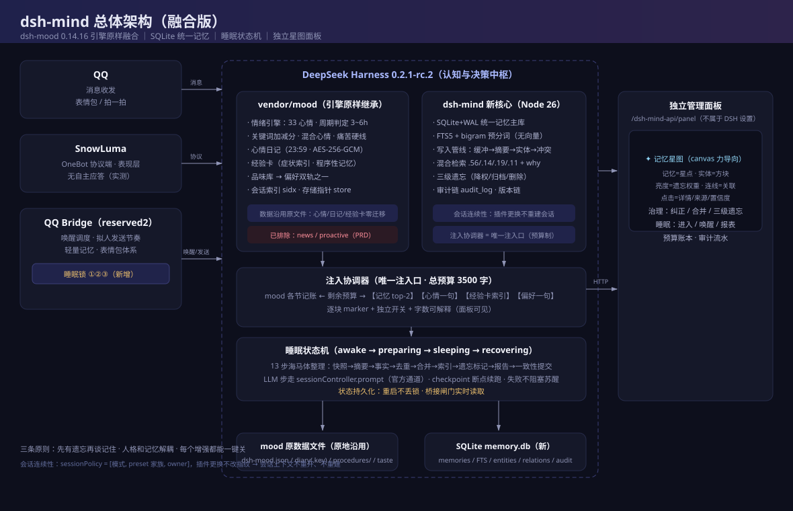

# Fathom · 深寻

**简体中文** | [English](README.en.md)

**给 AI 用的长期记忆 + 动态情绪 + 睡眠系统**

SQLite 记忆库 · FTS5 中文检索 · 提示词注入 · 四态睡眠状态机 · 3D 记忆星图面板



> `fathom` 是测海深的单位，也是「想明白、揣摩透」。记忆检索就是往深处捞——一次下潜，把沉下去的那件事带回来。

**MIT 许可 · 零运行时依赖 · 面板免构建 · 数据全在本地一个 SQLite 文件里**

- 仓库：<https://github.com/ZeZhizhan/Fathom>
- 问题反馈：<https://github.com/ZeZhizhan/Fathom/issues>

---

## 它是什么

DeepSeek Harness（DSH）的一个插件。装上之后，AI 会把对话里值得记的东西写进本地数据库，下次聊到相关话题时自动检索并注入提示词；同时维护一套情绪状态和一套「会累、会睡、睡醒要缓一会儿」的作息系统。所有状态都能在一个 3D 记忆星图面板里看到、编辑。

| 模块 | 说明 |
|---|---|
| **记忆** | SQLite + FTS5 中文 bigram 检索。跨会话、跨上下文压缩都还在 |
| **注入** | 每轮按预算把最相关的几条塞进系统提示词，正文完整可见 |
| **睡眠** | 四态状态机 + 疲惫值。按真实经过时间补算，不依赖定时器 |
| **星图** | 语义星团 + 中央核心，Three.js 粒子着色器 + 手写 Bloom |
| **心情** | 33 维情绪（基础 / 复合 / 当代三组） |
| **日记 / 经验卡 / 品味** | 每日日记、程序性卡片库、AI 自身偏好原则 |
| **记忆治理** | 搜索、筛选、排序、编辑、降权、物理删除 |
| **角色卡 / 消费 / 系统** | 只读预览、令牌用量账本、服务连接状态 |

---

## 关于名字：全自动，不写死

面板左上角显示的角色名、名字下方那行 `Fathom · 深寻`、**以及最左侧那个方块字**，全部自动获取，不需要配置。

方块字取角色名的**第一个字符**（中文取首字，英文取首字母大写）。

角色名本身按优先级探测，结果缓存 10 分钟：

| 优先级 | 来源 | 说明 |
|---|---|---|
| 1 | 环境变量 `DSH_MIND_ROLE_NAME` | 你显式指定 |
| 2 | qq-bridge `/api/status` 的 `role` | 桥接正在生效的角色，最准 |
| 3 | 角色卡目录里最新修改的 `.md` 文件名 | 桥接不可用时的本地依据 |
| 4 | `Fathom` | 都没有时的兜底 |

想改名：**直接点左上角的名字**，弹窗输入即可，持久化到 `state.json`，重启后仍生效。

---

## 安装（下载到本地，不用 npm 拉取）

本项目**没有发布到 npm**，也不需要 `npm install` 任何东西——运行时零依赖。

### 0. 前置

- **Node.js ≥ 24**（依赖内置的 `node:sqlite`，低版本没有）
- 一个能跑起来的 DeepSeek Harness 环境（DSH 负责提供 `webServer` 与工具注册）

### 1. 把仓库下载到本地

```bash
git clone https://github.com/ZeZhizhan/Fathom.git Fathom
```

或者网页上 **Code → Download ZIP** 解压到任意目录，例如：

```
D:\plugins\Fathom
```

### 2. 注册为本地插件

```bash
dsh plugin --profile web add D:\plugins\Fathom
```

`--profile web` 换成你实际使用的 profile 名。这条命令会把目录链接进该 profile 的 `node_modules`，DSH 下次启动就会加载 `cordis.patch.yml` 里声明的插件。

也可以在 profile 的 `cordis.patch.yml` 里手动挂载：

```yaml
plugins:
  - id: dsh-mind
    module: D:\plugins\Fathom
    config:
      inject: false      # 先只写不读，观察几天再打开
```

### 3. 重启 DSH

```bash
dsh web
```

启动日志里出现 `dsh-mind` 即加载成功。

### 4. 打开面板

```
http://127.0.0.1:3080/dsh-mind-api/panel
```

端口以你 `dsh web` 实际监听的为准。

> **面板不用构建**：仓库里 `panel/index.html` 已经是构建好的单文件（内联了 CSS 与前端 JS）。
> 只有你改了 `panel/src/*` 或 `panel/template.html` 之后，才需要 `npm run build`（等价于 `node scripts/build-panel.mjs`）。

### 5. 验证

- 面板能打开、左上角显示你的角色名 → 前端正常
- 星图上出现星团 → 数据库读写正常
- 问 AI 一件事，隔几轮再问它「记得我刚才说的吗」→ 注入链路正常（需要先打开注入开关）

---

## 推荐架构：接入 QQ（qq-bridge + SnowLuma）

Fathom 本体不依赖 QQ，**不装也能用**（面板、记忆、星图、睡眠照常）。但如果你希望 AI 真的「住在 QQ 里」跟人聊天，推荐这套组合：

```
QQ 客户端
   ↕  协议
SnowLuma        协议端（OneBot v11 实现，负责登录 QQ、收发消息）
   ↕  HTTP / WebSocket
qq-bridge       宿主侧桥接（会话编排、角色卡、令牌账本、主动消息）
   ↕
DSH + Fathom    记忆 / 情绪 / 睡眠 / 星图
```

| 组件 | 作用 | 仓库 |
|---|---|---|
| **qq-bridge** | 把 QQ 消息接进 DSH，并暴露 `/api/status`、角色卡目录、消费账本、语音发送 | <https://github.com/Derpyu520/qq-bridge> |
| **SnowLuma** | OneBot v11 协议端，负责真正连上 QQ | <https://github.com/SnowLuma/SnowLuma> |

### 为什么推荐这套

Fathom 有几个能力是**通过桥接拿到的**，装了才能全开：

| 能力 | 依赖 | 没有桥接时 |
|---|---|---|
| 面板显示角色名 | 桥接 `/api/status` 的 `role` | 回落到角色卡文件名，再回落到 `Fathom` |
| 角色卡页 | 桥接的角色卡目录 | 页面为空 |
| 消费页 | 桥接的令牌账本 | 页面为空 |
| 语音发到 QQ | 桥接 → SnowLuma → QQ | 只能生成音频，发不出去 |
| 主动消息 / 作息唤醒 | 桥接的调度 | 只在你会话时活动 |

> 连接信息**不会重复保存**：Fathom 只读 qq-bridge 的 `config.json`（或用环境变量 `QQ_BRIDGE_DIR` / `QQ_BRIDGE_CONFIG` 指过去），密钥仍在你桥接那边。

### 最小接线

1. 先按各自仓库说明把 **SnowLuma** 跑起来（登录 QQ，开启 OneBot v11 的 HTTP 服务端）
2. 再按说明把 **qq-bridge** 接到 DSH，配置里填 SnowLuma 的地址与 token
3. Fathom 这边什么都不用填——它自己会去找 `qq-bridge/config.json`
4. 重启 `dsh web`，打开面板「系统」页确认桥接与协议端都是绿的

---

## 配置

### 面板里能改的

**设置** 页可以热改，改完立即生效：

| 分组 | 项 |
|---|---|
| 提示词注入 | 启用注入、注入预算字符、检索条数、最低相关分、注入经验卡 / 品味 / 记忆摘要 |
| 语音 | 启用语音、模型（列表从 API 实时拉取）、语言、贴近原声、代理、每分钟 / 每小时上限 |
| 星图外观 | 自动旋转、显示标签、光晕 |

### 用环境变量配置的（不进面板、不落库）

密钥类的值**只从环境变量读**，避免跟着数据目录一起被备份/上传：

| 变量 | 用途 |
|---|---|
| `BREEZE_API_KEY` | 语音合成（BreezeBlue）的密钥 |
| `BREEZE_VOICE_ID` | 音色 ID，形如 `voc_xxxxxxxx` |
| `BREEZE_BASE_URL` | API 地址，默认 `https://api.breeze.blue` |
| `DSH_MIND_ROLE_NAME` | 强制指定面板显示的角色名 |
| `DSH_MIND_DATA_DIR` | 覆盖数据目录 |
| `QQ_BRIDGE_DIR` / `QQ_BRIDGE_CONFIG` | qq-bridge 目录（读角色卡、消费账本、语音发送） |

Windows（当前会话临时生效）：

```powershell
$env:BREEZE_API_KEY="你的密钥"
$env:BREEZE_VOICE_ID="voc_xxxxxxxx"
dsh web
```

Linux / macOS：

```bash
export BREEZE_API_KEY="你的密钥"
export BREEZE_VOICE_ID="voc_xxxxxxxx"
dsh web
```

没配语音的变量时，除「语音」以外的功能完全不受影响。

### 数据目录

默认 `$DSH_HOME/dsh-mind`：

```
memory.db     SQLite 主库（WAL），记忆 / 情绪 / 日记 / 经验卡 / 品味
state.json    睡眠状态、疲惫值、作息窗口、角色名
settings.json 面板里改过的设置
backup/       导入前的自动备份，可直接回滚
```

整个目录复制走就是完整备份；`memory.db` 可用 `VACUUM INTO` 做一致性快照。

---

## 数据与隐私

- 所有数据都在**你自己的机器**上，仓库里不含任何记忆数据（打包时已剥离数据库与状态文件）。
- 面板没有账号体系，不做任何外发；唯一会联网的是语音合成（你配了才会用）与星图里的 CDN-free 本地 Three.js（无外发）。
- 记忆正文可以用 `?mask=1` 演示模式打码，适合录屏截图。

---

## 技术栈与工程取舍

| 层 | 选择 |
|---|---|
| 运行时 | Node ≥ 24 内置 `node:sqlite`，**零第三方依赖** |
| 存储 | 单文件 SQLite + WAL；FTS5 只是索引，坏了能整体重建 |
| 检索 | 关键词覆盖率为主，配合图谱 / 重要度 / 新鲜度加权；不引入向量库 |
| 面板 | 纯 CSS 变量 + 语义类，无框架、无构建链；Three.js 本地内联 |
| 睡眠 | 四态状态机，按真实经过时间补算，不依赖定时器 |

---

## 目录结构

```
index.js            插件入口：工具注册、HTTP 路由（/dsh-mind-api/*）、注入协调
lib/
  db.js             SQLite 建表 / 迁移 / WAL / FTS5
  memory.js         记忆读写、检索打分、三级遗忘
  bigram.js         中文 bigram 分词（FTS5 用）
  retrieve.js       召回与重排
  pointer.js        对话 → 记忆的抽取判定
  consolidate.js    沉睡期间的整理（去重/合并/写日记/沉淀经验卡）
  sleep.js          睡眠状态机与疲惫值
  tts.js            BreezeBlue 合成 + OneBot 语音发送
  render.js         工具返回值的人类可读渲染
panel/
  index.html        构建产物（单文件，直接可服务）
  template.html     模板
  src/*.css|app.js  前端源码（改完 npm run build）
  universe.js       星图渲染
  vendor/           Three.js 本地副本
vendor/mood/        内联的 dsh-mood（33 维情绪 / 日记 / 经验卡 / 品味）
test/               node --test 单元测试
```

---

## 常见问题

**面板白屏？**
先确认 `panel/index.html` 存在（构建产物）；再确认访问的是 `/dsh-mind-api/panel`，而不是静态目录。

**端口不是 3080？**
面板地址跟着 `dsh web` 的端口走，日志里会打印实际地址。

**装完看不到记忆？**
注入默认关闭（只写不读）。先去「设置 → 提示词注入」打开总开关，聊几轮再看。

**Node 版本低？**
`node:sqlite` 需要 Node 24+。22.x 需要 `--experimental-sqlite`，不推荐。

**想换机器带走数据？**
复制 `$DSH_HOME/dsh-mind` 整个目录即可。

---

## 许可

MIT。详见 [LICENSE](LICENSE) 与 [NOTICE.md](NOTICE.md)（含内联第三方组件的许可说明）。
